<p align="center">
  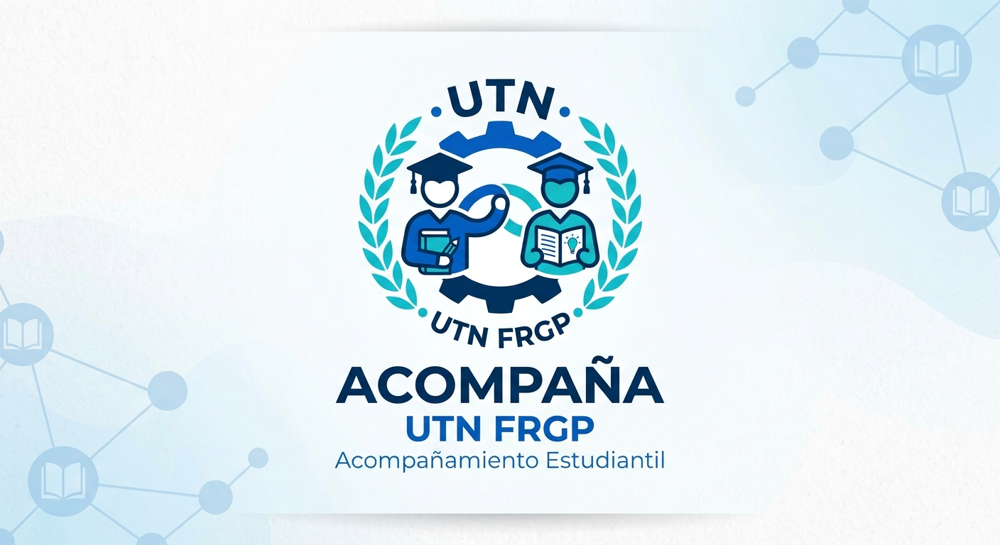
</p>

<h1 align="center">Acompaña</h1>

<p align="center">
  <strong>Plataforma de acompañamiento académico entre pares</strong><br/>
  Trabajo Final Integrador — Tecnicatura Universitaria en Programación<br/>
  <a href="https://www.frgp.utn.edu.ar/">Universidad Tecnológica Nacional — Facultad Regional General Pacheco</a>
</p>

<p align="center">
  
  
  
  
  
  
  
</p>

---

## 📖 ¿Qué es Acompaña?

**Acompaña** es una aplicación web diseñada para fortalecer el **acompañamiento académico entre estudiantes** de la UTN FRGP. La plataforma conecta alumnos que necesitan ayuda en determinadas materias con compañeros que ya las aprobaron y están dispuestos a ser tutores.

### 🎯 Problemática que resuelve

En el ámbito universitario, muchos estudiantes enfrentan dificultades académicas y no siempre cuentan con acceso rápido a apoyo personalizado. Las tutorías institucionales suelen tener cupos limitados y horarios fijos. **Acompaña** busca resolver esto mediante:

- **Conexión directa entre pares**: Un alumno que aprobó una materia puede postularse como tutor, y otro alumno puede encontrarlo y solicitarle ayuda.
- **Intercambio de material de estudio**: Los alumnos pueden subir y compartir apuntes organizados por materia y carrera.
- **Gestión administrativa centralizada**: Los administradores pueden gestionar usuarios, moderar contenido y administrar el catálogo académico desde un panel dedicado.

### ✨ Funcionalidades principales

| Módulo | Descripción |
|---|---|
| 🔐 **Autenticación** | Registro de alumnos con validación de datos institucionales (DNI, correo, legajo). Login con JWT y control de roles (Alumno / Admin). |
| 👤 **Perfil de usuario** | Cada alumno puede editar sus datos personales, cambiar su foto de perfil y su contraseña. |
| 🎓 **Materias aprobadas** | Los alumnos cargan las materias que aprobaron y la nota obtenida, habilitándose como posibles tutores. |
| 🤝 **Sistema de tutorías** | Búsqueda de tutores por materia con preferencia de contacto (Mail / WhatsApp / Llamada). Envío y gestión de solicitudes de tutoría (pendiente, aceptada, rechazada, finalizada). Campo de necesidades de apoyo accesible (intérprete de LSA, material escrito, encuentro virtual con subtítulos). |
| 📚 **Apuntes compartidos** | Subida y descarga de apuntes (PDF, imágenes, documentos) organizados por materia. |
| 🔔 **Sistema de avisos** | Campanita de notificaciones en tiempo real: avisa al alumno cuando sus solicitudes de tutoría son aceptadas o rechazadas. Lectura en voz alta de cada aviso. |
| ♿ **Accesibilidad** | Modo daltónico, fuente para dislexia (OpenDyslexic), dictado por voz, lectura en voz alta, skip link, navegación por teclado, focus traps en modales, ARIA roles, y más (ver sección dedicada). |
| 🛡️ **Panel de administración** | Gestión de usuarios (alta, edición, habilitación/deshabilitación), moderación de apuntes y ABM del catálogo de carreras y materias con baja lógica, reactivación y eliminación con control de dependencias. |

---

## 📸 Capturas de pantalla

### Autenticación
<p align="center">
  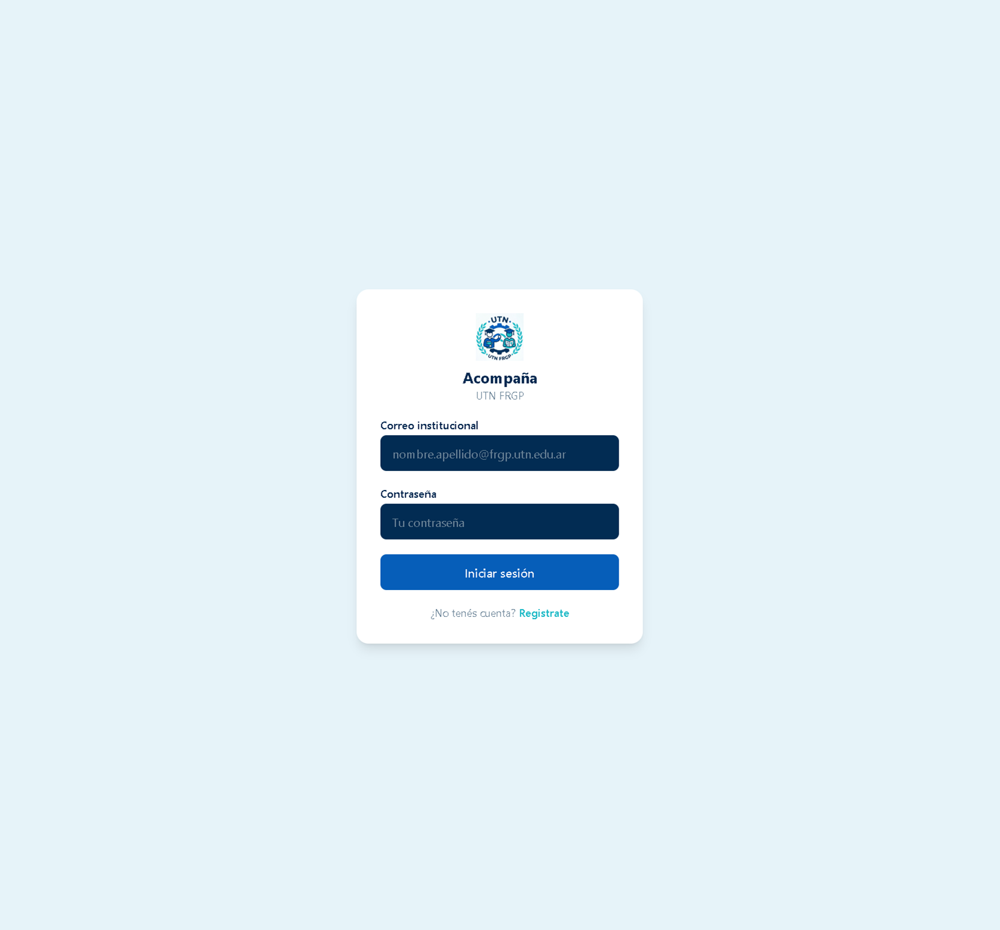
</p>

### Vista del Alumno
<p align="center">
  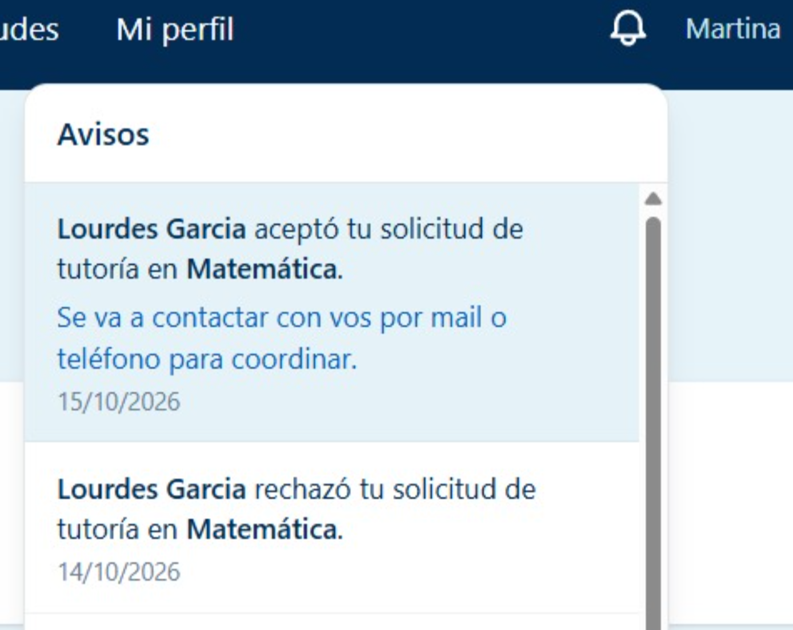
</p>
<p align="center">
  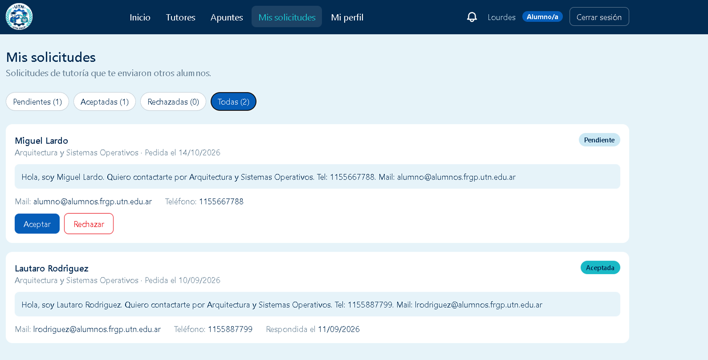
</p>
<p align="center">
  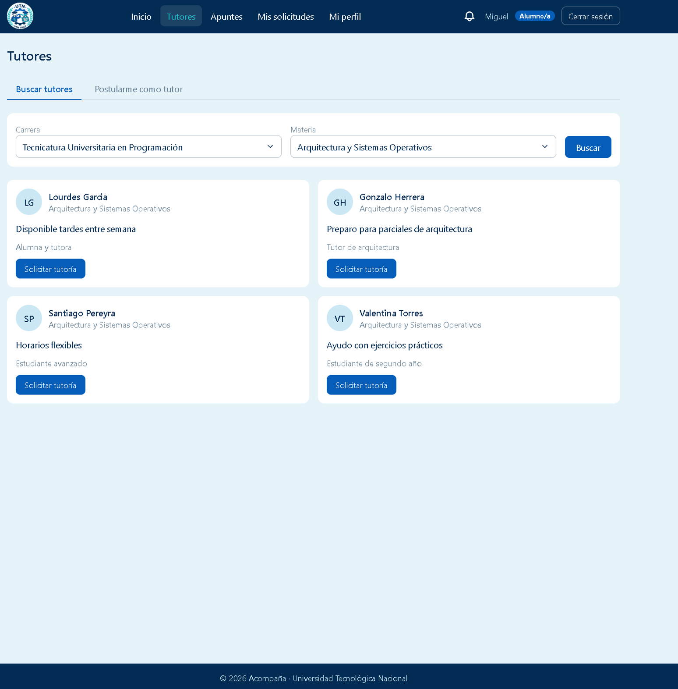
</p>

### Apuntes
<p align="center">
  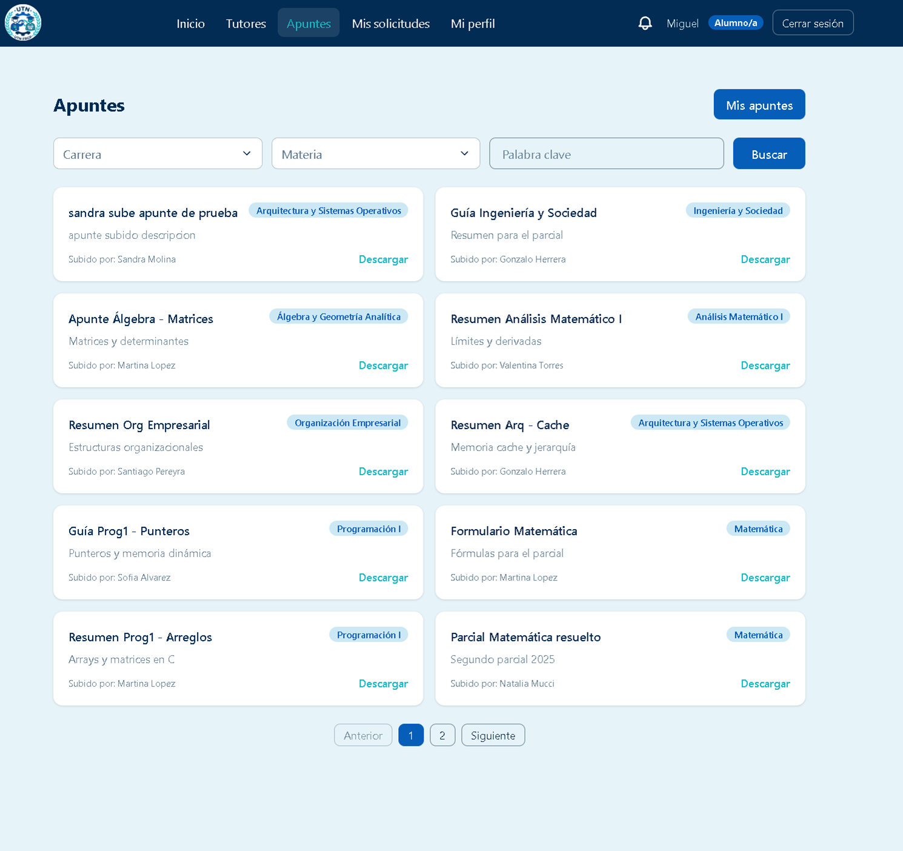
</p>
<p align="center">
  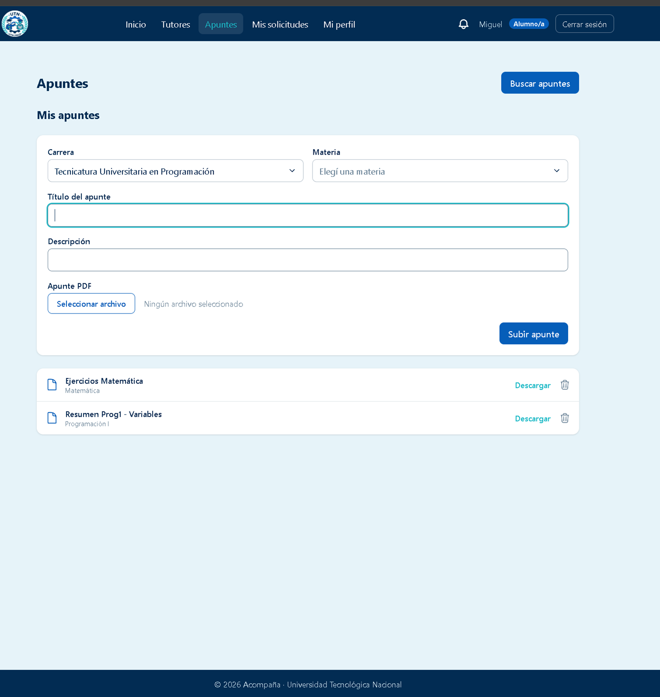
</p>

### Perfil
<p align="center">
  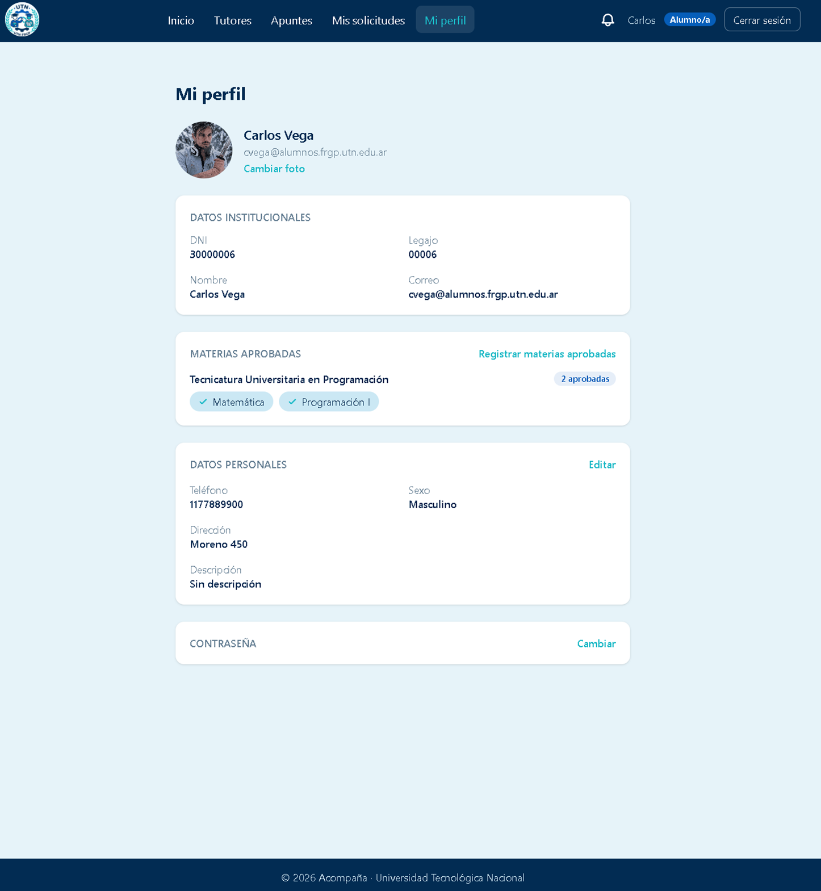
</p>

### Panel de Administración
<p align="center">
  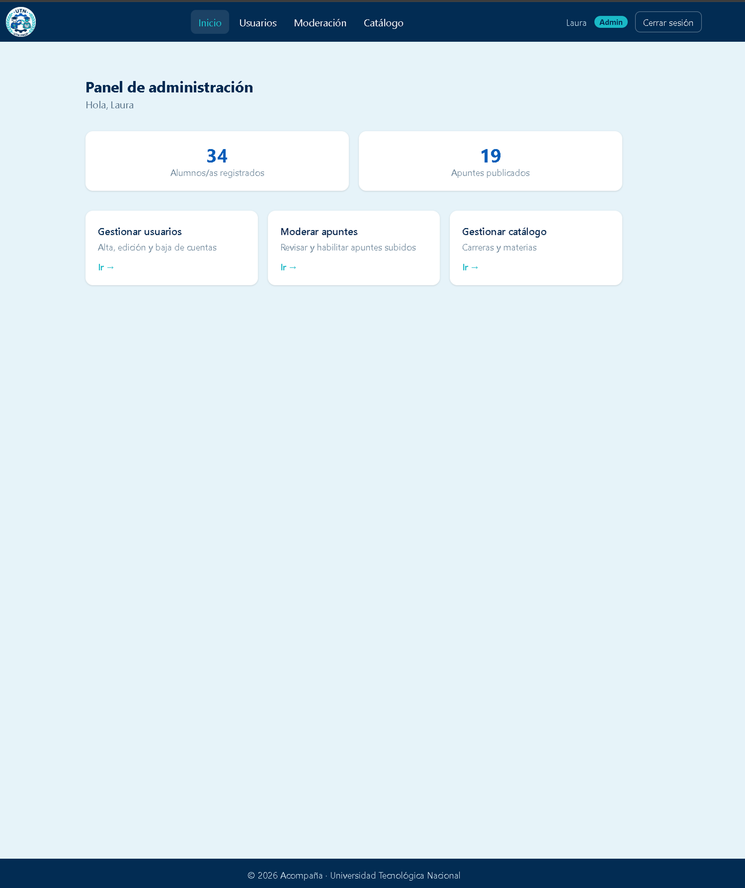
</p>
<p align="center">
  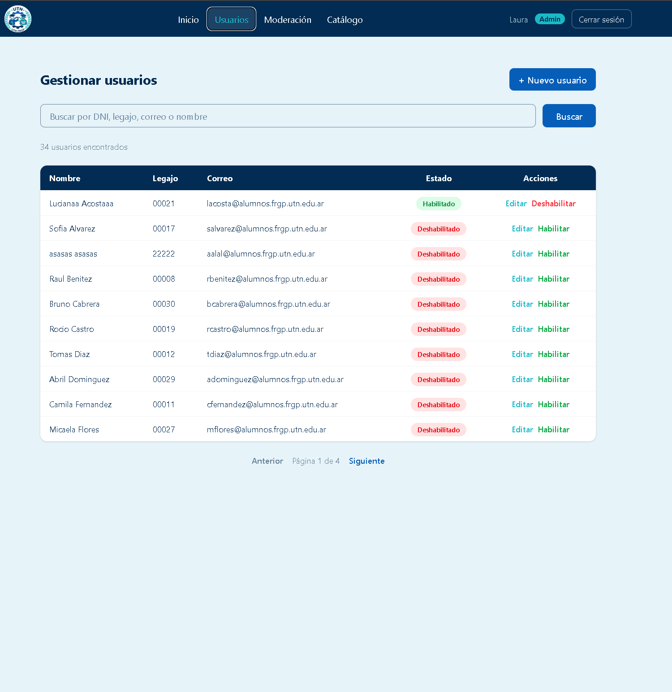
</p>
<p align="center">
  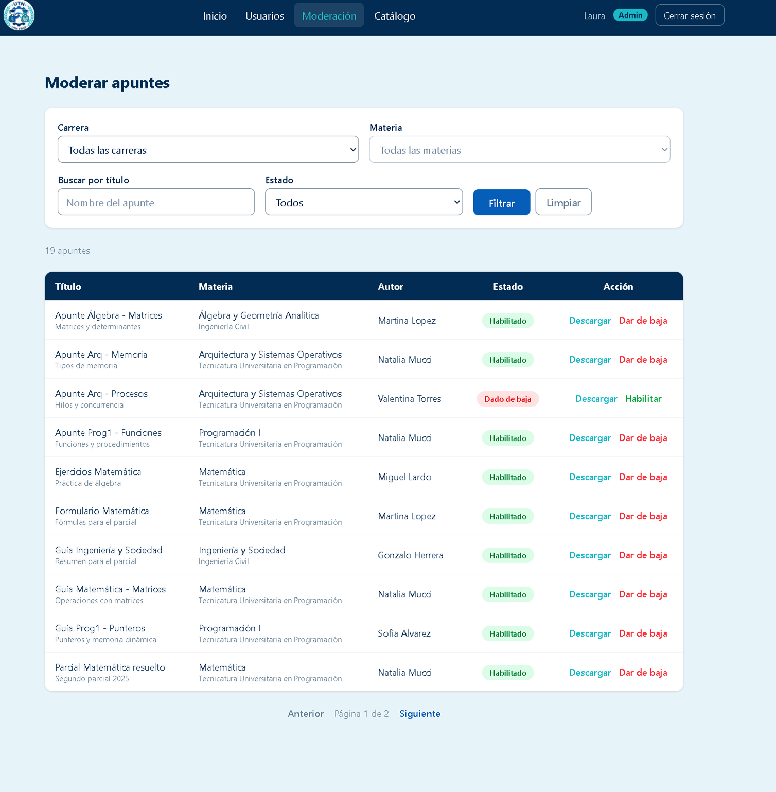
</p>
<p align="center">
  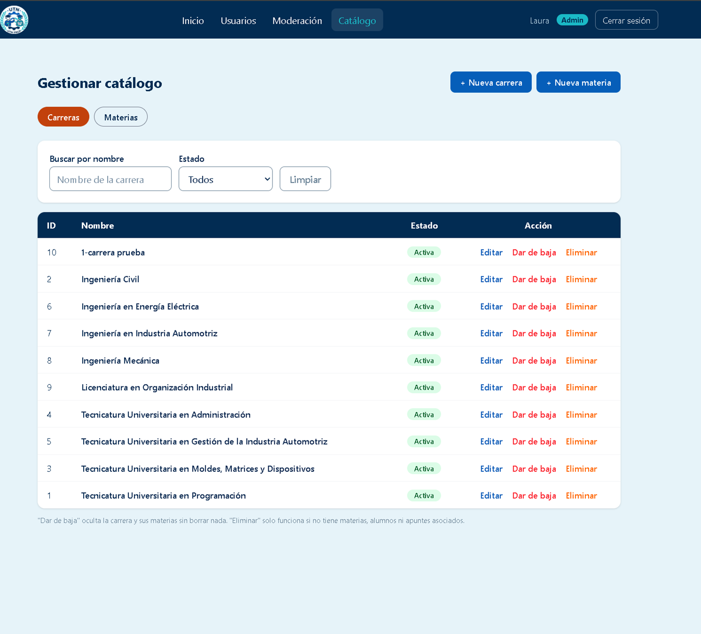
</p>

---

## ♿ Accesibilidad

La plataforma fue diseñada con un fuerte enfoque en **inclusión digital**, implementando funcionalidades de accesibilidad que van más allá del cumplimiento básico de estándares:

### 🎨 Modo Daltónico

Un interruptor disponible desde el panel de accesibilidad (y también en la pantalla de login) aplica una **paleta de colores alternativa** optimizada para personas con daltonismo. Reemplaza todos los colores de la interfaz (azules, verdes, rojos, ambar) por equivalentes distinguibles, y agrega subrayado a los links para que no dependan solo del color.

### 🔤 Fuente para Dislexia

Activa la tipografía **OpenDyslexic**, una fuente diseñada para mejorar la legibilidad en personas con dislexia. Aumenta el espaciado entre palabras y adapta el ancho de formularios para mantener la comodidad visual.

### 🗣️ Lectura en Voz Alta (Text-to-Speech)

Botón integrado en las **notificaciones**, la **búsqueda de tutores** y la **bandeja de solicitudes** que lee el contenido en voz alta usando la Web Speech API con voz en español argentino (`es-AR`).

### 🎙️ Dictado por Voz

Dos niveles de dictado por voz:

- **Dictado por campo**: botones dedicados en la búsqueda de tutores, postulación como tutor y búsqueda de apuntes.
- **Dictado global**: al enfocar **cualquier** campo de texto de la aplicación aparece automáticamente un ícono de micrófono. Atajo de teclado: `Alt + M`. Adaptación inteligente para campos de email (`arroba` → `@`, `punto` → `.`).

### ⌨️ Navegación por Teclado

- **Skip link** ("Saltar al contenido") visible al presionar `Tab`, para acceder directamente al contenido principal.
- **Focus visible mejorado**: contorno de 3px en todos los elementos interactivos al navegar con teclado.
- **Dropdowns accesibles** (`SelectorDesplegable`): navegación completa con flechas ↑↓, `Home`, `End`, `Escape` y `Enter`, con roles ARIA (`listbox`, `option`, `aria-selected`).
- **Focus trap en modales**: el foco queda contenido dentro del modal al navegar con `Tab`, y se restaura al elemento previo al cerrar.

### 🏷️ ARIA y HTML Semántico

- Roles semánticos: `dialog`, `switch`, `tablist`, `tab`, `listbox`, `option`, `alert`, `status`.
- Atributos ARIA: `aria-label`, `aria-expanded`, `aria-checked`, `aria-selected`, `aria-modal`, `aria-pressed`, `aria-haspopup`, `aria-live` (regiones vivas para lectores de pantalla).
- HTML semántico: `<header>`, `<nav>`, `<main>`, `<footer>`, `<section>`, `<article>`, `<fieldset>`, `<legend>`.
- Texto alternativo (`alt`) en todas las imágenes; SVGs decorativos marcados con `aria-hidden="true"`.
- Toasts con `aria-live="polite"` y `role="status"` para notificaciones no intrusivas.

### 🤝 Necesidades de Apoyo en Tutorías

Al solicitar una tutoría, el alumno puede indicar sus **necesidades de apoyo accesible**:

- Intérprete de LSA (Lengua de Señas Argentina)
- Material por escrito
- Encuentro virtual con subtítulos
- Campo libre con dictado por voz

Esta información se incluye automáticamente en el mensaje que recibe el tutor.

### 🔑 Accesibilidad desde el Login

Los interruptores de modo daltónico y fuente para dislexia están disponibles **antes de iniciar sesión**, asegurando que la plataforma sea accesible desde el primer contacto. Las preferencias se guardan en `localStorage` y persisten entre sesiones.

---

## 🏗️ Arquitectura del proyecto

```
Tesis-UTN/
├── backend/                 # API REST
│   ├── server.js            # Entry point — levanta Express + conecta a PostgreSQL
│   ├── src/
│   │   ├── config/          # Configuración de base de datos y uploads
│   │   ├── controllers/     # Reciben la request, llaman al service, arman la response
│   │   ├── middlewares/     # Auth (JWT), roles, manejo de errores, upload de archivos
│   │   ├── models/          # Modelos Sequelize (ORM) — mapeo a tablas PostgreSQL
│   │   ├── routes/          # Definición de endpoints de la API
│   │   ├── services/        # Lógica de negocio y consultas a la DB
│   │   ├── utils/           # Utilidades (respuestas estandarizadas)
│   │   └── validations/     # Validaciones de entrada (express-validator)
│   └── uploads/             # Archivos subidos (fotos de perfil, apuntes)
│
├── frontend/                # SPA (Single Page Application)
│   ├── src/
│   │   ├── components/      # Componentes reutilizables (Navbar, Footer, Modales, Toasts)
│   │   ├── layouts/         # Layout principal con Navbar + Footer
│   │   ├── router/          # Rutas de la SPA con guards por rol
│   │   ├── services/        # Capa de comunicación con la API (fetch + JWT automático)
│   │   ├── stores/          # Estado global con Pinia (sesión, accesibilidad, notificaciones, toasts)
│   │   ├── utils/           # Utilidades (formateo de fechas, query strings)
│   │   └── views/           # Páginas (Login, Registro, Perfil, Admin, Tutorías, Apuntes)
│   └── vite.config.js       # Configuración de Vite + plugins
│
└── docs/                    # Documentación
    ├── DER.png              # Diagrama Entidad-Relación
    ├── script.sql           # Script completo de creación de la DB + datos de prueba
    └── *.png / *.jpg        # Capturas de pantalla y logo
```

### Flujo de una petición

```
Cliente (Navegador)
    │
    ▼
  fetch('http://localhost:3000/api/auth/login', { method: 'POST', body: {...} })
    │
    ▼
┌─ Backend (Express) ───────────────────────────────────────────────┐
│                                                                    │
│   Route          →   Validation      →   Controller   →  Service  │
│   (auth.routes)      (auth.validation)   (auth.ctrl)     (auth.svc)│
│                                                                    │
│   "¿Qué URL?"       "¿Datos válidos?"   "Coordina"     "Lógica    │
│                                                          de        │
│                                                          negocio"  │
│                                                              │     │
│                                                              ▼     │
│                                                          Sequelize │
│                                                          (ORM)     │
│                                                              │     │
└──────────────────────────────────────────────────────────────┼─────┘
                                                               │
                                                               ▼
                                                         PostgreSQL
                                                         (Docker)
```

---

## 🛠️ Stack tecnológico

### Backend
| Tecnología | Versión | Uso |
|---|---|---|
| **Node.js** | 18+ | Runtime de JavaScript en el servidor |
| **Express** | 4.21 | Framework web para crear la API REST |
| **Sequelize** | 6.37 | ORM para mapear modelos a tablas PostgreSQL |
| **PostgreSQL** | 16 | Base de datos relacional |
| **bcryptjs** | 3.x | Hashing seguro de contraseñas |
| **jsonwebtoken** | 9.x | Generación y verificación de tokens JWT |
| **express-validator** | 7.x | Validación y sanitización de datos de entrada |
| **multer** | 1.4 | Upload de archivos (fotos de perfil, apuntes) |
| **Cloudinary** | 2.x | Almacenamiento de imágenes en la nube (opcional) |
| **dotenv** | 16.x | Variables de entorno |
| **nodemon** | 3.x | Reinicio automático en desarrollo |

### Frontend
| Tecnología | Versión | Uso |
|---|---|---|
| **Vue.js** | 3.5 | Framework reactivo para la interfaz de usuario |
| **Vite** | 8.3 | Bundler y servidor de desarrollo ultrarrápido |
| **Tailwind CSS** | 4.3 | Framework de utilidades CSS para diseño responsivo |
| **Pinia** | 4.x | Store de estado global (sesión, accesibilidad, notificaciones, toasts) |
| **Vue Router** | 5.x | Enrutamiento SPA con guards de autenticación y rol |
| **Web Speech API** | — | Lectura en voz alta (SpeechSynthesis) y dictado por voz (SpeechRecognition) |
| **OpenDyslexic** | — | Tipografía optimizada para personas con dislexia |

### Infraestructura
| Tecnología | Uso |
|---|---|
| **Docker** | Contenedores para PostgreSQL y pgAdmin |
| **pgAdmin** | Interfaz gráfica para administrar la base de datos |
| **Git / GitHub** | Control de versiones y trabajo colaborativo |

---

## 📐 Diagrama Entidad-Relación (DER)

<p align="center">
  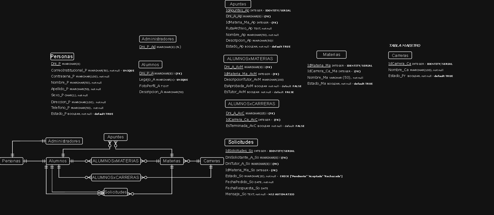
</p>

### Tablas del sistema

| Tabla | Descripción | Relaciones clave |
|---|---|---|
| `Personas` | Datos personales (DNI, nombre, correo, contraseña) | Tabla base (TPT) |
| `Alumnos` | Extensión de Persona (descripción, foto de perfil) | 1:1 con Personas |
| `Administradores` | Extensión de Persona (rol admin) | 1:1 con Personas |
| `Carreras` | Catálogo de carreras (nombre, estado) | 1:N con Materias |
| `Materias` | Catálogo de materias por carrera | N:1 con Carreras |
| `ALUMNOSxCARRERAS` | Asociación alumno ↔ carrera | N:M |
| `ALUMNOSxMATERIAS` | Materias aprobadas (nota, disponible como tutor) | N:M |
| `Apuntes` | Material de estudio subido por alumnos | N:1 con Alumnos y Materias |
| `Solicitudes` | Solicitudes de tutoría entre alumnos | N:1 con Alumnos (×2: solicitante y tutor) |

---

## 🚀 Instalación y puesta en marcha

### Prerrequisitos

- [Node.js](https://nodejs.org/) v18 o superior
- [Docker Desktop](https://www.docker.com/products/docker-desktop/) (para PostgreSQL y pgAdmin)
- [Git](https://git-scm.com/)

### 1. Clonar el repositorio

```bash
git clone https://github.com/EllaRohana/Tesis-UTN.git
cd Tesis-UTN
```

### 2. Levantar la base de datos con Docker

Asegurate de tener Docker Desktop corriendo, luego levantá PostgreSQL y pgAdmin:

```bash
# Ejemplo con docker run (o usá docker-compose si tenés uno configurado)
docker run --name postgres-acompana -e POSTGRES_DB=acompana -e POSTGRES_USER=tu_usuario -e POSTGRES_PASSWORD=tu_password -p 5432:5432 -d postgres:16

docker run --name pgadmin-acompana -e PGADMIN_DEFAULT_EMAIL=admin@admin.com -e PGADMIN_DEFAULT_PASSWORD=admin -p 5050:80 -d dpage/pgadmin4
```

### 3. Crear las tablas y cargar datos de prueba

Abrí pgAdmin en `http://localhost:5050`, conectate al servidor PostgreSQL y ejecutá el script:

📄 [`docs/script.sql`](docs/script.sql)

### 4. Configurar el Backend

```bash
cd backend
cp .env.example .env
```

Editá el archivo `.env` con tus datos de conexión:

```env
DB_HOST=localhost
DB_PORT=5432
DB_NAME=acompana
DB_USER=tu_usuario
DB_PASSWORD=tu_password
JWT_SECRET=un_secreto_seguro_para_produccion
JWT_EXPIRES_IN=24h
PORT=3000
```

Instalá dependencias y levantá el servidor:

```bash
npm install
npm run dev
```

✅ Deberías ver:
```
✅ Conexión a PostgreSQL exitosa
🚀 Servidor corriendo en http://localhost:3000
```

### 5. Configurar el Frontend

En **otra terminal**:

```bash
cd frontend
cp .env.example .env.local
npm install
npm run dev
```

✅ Deberías ver:
```
  VITE v8.x.x  ready in XXX ms

  ➜  Local:   http://localhost:5173/
```

### 6. ¡Listo!

Abrí tu navegador en **http://localhost:5173** y empezá a usar Acompaña. 🎉

---

## 📋 Endpoints de la API

| Método | Ruta | Descripción | Acceso |
|---|---|---|---|
| `POST` | `/api/auth/register` | Registrar nuevo alumno | Público |
| `POST` | `/api/auth/login` | Iniciar sesión (devuelve JWT) | Público |
| `GET` | `/api/usuarios/me` | Ver perfil propio | Autenticado |
| `PATCH` | `/api/usuarios/me` | Editar datos personales | Autenticado |
| `PATCH` | `/api/usuarios/me/foto` | Subir/cambiar foto de perfil | Autenticado |
| `PATCH` | `/api/usuarios/me/contrasena` | Cambiar contraseña | Autenticado |
| `GET` | `/api/usuarios?q=` | Buscar usuarios | Admin |
| `POST` | `/api/usuarios` | Dar de alta un alumno | Admin |
| `PATCH` | `/api/usuarios/:dni` | Editar datos de un usuario | Admin |
| `PATCH` | `/api/usuarios/:dni/estado` | Habilitar / Deshabilitar usuario | Admin |
| `GET` | `/api/catalogo/carreras` | Listar carreras | Autenticado |
| `GET` | `/api/catalogo/materias` | Listar materias | Autenticado |
| `POST` | `/api/catalogo/carreras` | Crear carrera | Admin |
| `POST` | `/api/catalogo/materias` | Crear materia | Admin |
| `PATCH` | `/api/catalogo/carreras/:id` | Renombrar carrera | Admin |
| `PATCH` | `/api/catalogo/materias/:id` | Renombrar materia | Admin |
| `PATCH` | `/api/catalogo/carreras/:id/baja` | Baja lógica de carrera | Admin |
| `PATCH` | `/api/catalogo/carreras/:id/reactivar` | Reactivar carrera | Admin |
| `DELETE` | `/api/catalogo/carreras/:id` | Eliminar carrera (si no tiene dependencias) | Admin |
| `GET` | `/api/materias-aprobadas` | Materias aprobadas del alumno | Alumno |
| `GET` | `/api/tutores` | Buscar tutores disponibles | Alumno |
| `POST` | `/api/tutorias` | Postularse como tutor | Alumno |
| `GET` | `/api/solicitudes` | Ver solicitudes de tutoría | Alumno |
| `POST` | `/api/solicitudes` | Enviar solicitud de tutoría | Alumno |
| `PATCH` | `/api/solicitudes/:id` | Aceptar / Rechazar / Finalizar solicitud | Alumno |
| `GET` | `/api/solicitudes/avisos` | Obtener notificaciones del alumno | Alumno |
| `GET` | `/api/apuntes` | Listar apuntes | Alumno |
| `POST` | `/api/apuntes` | Subir apunte | Alumno |
| `GET` | `/api/moderacion` | Listar apuntes para moderar | Admin |
| `PATCH` | `/api/moderacion/:id/estado` | Habilitar / Dar de baja apunte | Admin |

---

## 👥 Contribuyentes

<table align="center">
  <tr>
    <td align="center" width="250">
      <strong>Ella Rohana Venice Lo Re Mansilla</strong>
    </td>
    <td align="center" width="250">
      <strong>María Lourdes García</strong>
    </td>
    <td align="center" width="250">
      <strong>Miguel Ángel Lardo</strong>
    </td>
  </tr>
</table>

---

## 📄 Licencia

Proyecto académico desarrollado como Trabajo Final Integrador para la **Tecnicatura Universitaria en Programación** de la [UTN — Facultad Regional General Pacheco](https://www.frgp.utn.edu.ar/).

---

<p align="center">
  <em>Hecho con ❤️ en UTN FRGP — 2026</em>
</p>
